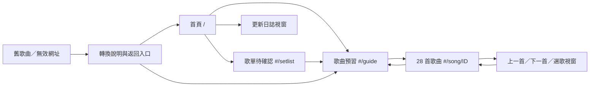

# 米津玄師網站本機架構驗收

2026-11-18（Asia/Taipei），工作版本 **3.0.1**。本次使用 Node 24.16.0、Vite 7.3.8、Windows Edge 無頭瀏覽器，測試本機正式建置。

在本次涵蓋的範圍內，靜態 PWA 的頁面、導覽、資料載入與離線架構可正常運作，沒有發現阻礙主要流程的缺頁或程式錯誤。歌曲內容及正式演出歌單仍按來源狀態顯示待補／待確認。

## 結果

| 檢查 | 結果 | 證據 |
|---|---|---|
| 架構與完整路由 | 56 項通過、0 項失敗 | [架構報告](report.json) |
| 播放器狀態、跨日場次及離線 | 42 項通過、0 個未捕捉錯誤 | [媒體狀態報告](player/report.json) |
| 歌曲直接網址 | 28／28 正常，固定編號與標題一致 | report.json 的 routes |
| 全部歌曲首次離線開啟 | 28／28 正常；有影片者顯示離線、無完整影片者維持待核實 | 架構報告的離線檢查 |
| 本地主要資源 | 15 項均回傳 HTTP 200，JS／CSS／圖片 MIME 正確 | report.json 的 assets |
| PWA 圖示 | manifest 宣告的 3 張 PNG 均可讀取，尺寸與宣告一致 | 架構報告的 manifest 檢查 |
| 應用程式錯誤與本地載入失敗 | 均為 0 | pageErrors、localRequestFailures |
| 建置及設定 | build、check:guide、check:deployment、git diff --check 通過 | 下列重跑方式 |

架構測試使用 http://localhost:4175/ 的隔離建置。原有 localhost:4174 預覽在測試期間被其他建置更新，搜尋索引 metadata 改變，因此最後驗收改用獨立輸出，兩份報告均以相同的固定版本重跑。本次沒有將該 metadata 差異判定為應用程式缺陷，也沒有修改原預覽的設定。

## 已實測的頁面與流程



- 首頁海報、兩場選擇、票務、公告、座位、交通及入場提醒；五張資訊卡可展開／收合，內容的 inert 與 aria 狀態相符，圖片可載入。
- 更新日誌延後載入，開啟時移動焦點、關閉後回復焦點；背景不接受操作。
- 原題、羅馬字及固定編號搜尋、找不到結果、清除搜尋、名稱排序、排序偏好保存及深淺色保存。
- 清單的 28 列逐一捲動後均可顯示，各曲可直接開啟，控制項依資料可用性停用，沒有用假歌詞或假時間填補。
- 上一首／下一首依固定預習順序循環、選歌視窗搜尋與跳轉、簡潔模式保存、瀏覽器前進／返回，以及無效編碼與舊歌曲網址的復原入口。
- 首頁、清單及歌曲頁測試 375、390、768、1440px；既有播放器測試另含 430px。座位圖展開後沒有裁切，頁面沒有水平溢出。
- 真實 Service Worker 安裝與接管、離線重新整理、28 首歌曲首次離線載入及座位圖快取。
- manifest、圖示尺寸、SW 版本、延後載入的 JS 分檔、CSS 及活動圖片均可讀取。未設定部署網址的隔離建置維持 noindex；部署測試另驗證設定網址後的 canonical、robots 及 sitemap。

## 截圖

- [手機首頁](home-mobile.png)
- [桌面預習清單](guide-desktop.png) · [手機清單尾端](guide-end-mobile.png)
- [手機待補影片歌曲頁](pending-song-mobile.png)
- [展開座位圖](player/home-390.png) · [桌面歌曲頁](player/song-1440.png)

已目視檢查首頁、待補影片頁及清單截圖。清單使用 content-visibility 延後繪製，改以實際逐列捲動與視窗截圖驗證，避免全頁截圖把尚未繪製的區域誤呈現為空白。

## 仍待補充與未驗證範圍

28 首的原文、繁中翻譯、讀音與同步時間仍待補；8 首完整歌曲影片尚待核實，兩首已公布新曲保持公告／預告入口。正式台北場歌單、周邊、入場動線及專屬接駁仍按公告狀態顯示。

本次沒有驗證 YouTube 實際串流、第三方網站可用性、原生 PiP 視窗、Safari、實體手機、安裝到手機主畫面的實際流程或正式部署。架構測試攔截外部 YouTube 與字型請求；播放器測試使用受控 API fixture，驗證換歌、緩衝、禁止自動播放、嵌入錯誤、離線與待補轉換。這些結果不能當成 20 首影片已可實際播放的證明。

## 重跑

使用專案既有依賴，將 Playwright Core 安裝於外部測試目錄。PowerShell 中先清除本次測試程序的 SITE_URL、CF_PAGES_URL，再執行：

```powershell
npm run build -- --outDir node_modules/.cache/yonezu-architecture-dist --emptyOutDir
npm run preview -- --host localhost --port 4175 --strictPort --outDir node_modules/.cache/yonezu-architecture-dist
```

於另一個終端使用同一份建置測試：

```powershell
$env:YONEZU_QA_BASE_URL = 'http://localhost:4175/'
node scripts/check-site-architecture.mjs '<外部 playwright-core/index.mjs 路徑>'
$env:YONEZU_QA_OUTPUT = 'artifacts/local-architecture-2026-11-18/player'
node scripts/check-player-browser.mjs '<外部 playwright-core/index.mjs 路徑>'
npm run check:guide
npm run check:deployment
git diff --check
```

架構腳本的輸出目錄可透過 YONEZU_ARCH_QA_OUTPUT 調整。本次只新增測試腳本與驗收證據，未修改應用程式行為，沒有提交、推送或部署。
